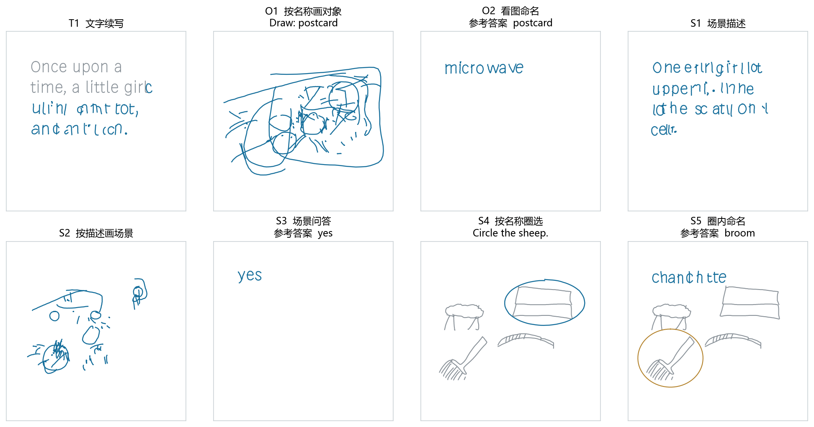

# CoSE Research

**Generative learning over written and graphical strokes.**

An ongoing personal research project exploring human paper-and-pen expression
as a learning medium. Writing, drawings, spatial layout, and operations such as
circling are represented through a common sequence of strokes.

This work extends [the original CoSE](https://github.com/eth-ait/cose). A stroke
autoencoder encodes both shape and absolute canvas position into a continuous
48-dimensional latent; a progress-conditioned decoder reconstructs the curve.
The current page-based prior is a 100.1M-parameter block-causal diffusion model.

## What is being explored

The long-term question is how predictive learning can acquire the organization
and use of human graphical expression. The current prototype studies a smaller
set of text, object, and synthetic-scene tasks: continuation, drawing from a
name, naming a drawing, scene description, scene drawing, questions, circling,
and naming a circled object.


## Evidence from the current prototype

After one billion additional successful inputs, circle-selection accuracy
increased from **41.0% to 50.8% on 512 paired synthetic scenes**. The paired
increase is 9.8 percentage points, with a recorded 95% interval of 6.0 to 13.3.
Conditional-use and generated-history diagnostics are in [results](docs/results.md).



The panel retains the first preselected example for every task from the
recorded evaluation, including incorrect names and selections. Gray strokes
are provided context, blue strokes are generated; the orange circle in S5 is
part of its input. Longer text, object structure, and visual correspondence
remain limited. See the [gallery caption](docs/gallery.md) for provenance.

Current work rebalances task contributions and mixes 4/8/16-stroke blocks.
The published measurements above precede that stage; its capability results
are not yet included.

## Source-only quick start

Python 3.10 or later, with a suitable PyTorch build:

```bash
python -m pip install -r requirements.txt
python scripts/check_release.py
python -m scripts.checks.check_page_diffusion
python -m src.st.train_page_diffusion --help
```

The first two checks use synthetic CPU inputs, without private data or weights.
Full training and sampling require a matching stroke AE and prepared data.
See [reproduction and asset status](docs/reproduction.md), [method](docs/method.md),
and [research status](docs/roadmap.md).

## Repository and license

The active model is in `src/st/`; shared layout and scene utilities are in
`src/`. Research recipes are in `configs/`, while `scripts/` includes checks,
demonstrations, and analyses. Historical logs and local cluster settings are
kept outside this release.

The existing GPL-3.0 license and source attribution are retained. This is a
research extension of CoSE; the current work's results are distinct from those
of the original paper. See [third-party notices](THIRD_PARTY_NOTICES.md).
