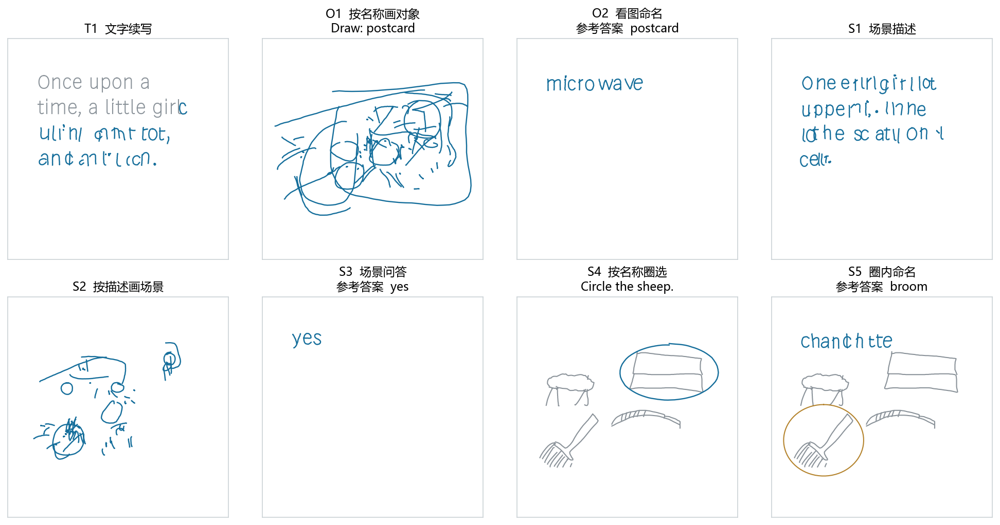

# Fixed generated examples

This page shows the current diffusion stage. The separate
[historical GMM gallery](historical_gmm.md) contains earlier object and scene
drawings, checkpoint comparisons, and auxiliary-readout text continuations.

This is the unedited first preselected example from each of the eight task
families in the 2026-11-05 evaluation, copied from `generated_samples.png` in
the recorded diagnostic bundle. The original evaluation also contains a larger
40-page sample booklet; this release displays the fixed eight-task overview.

Gray is provided context, blue is generated output, and orange is the supplied
circle for S5. Titles include the task and, where applicable, the reference
answer. The O2 postcard is incorrectly named microwave; the S4 sheep instruction
circles a different object. Text and drawings are raw model outputs, not
retouched demonstrations. The panel illustrates task format and observed
limitations; aggregate selection accuracy is reported in results.md.
