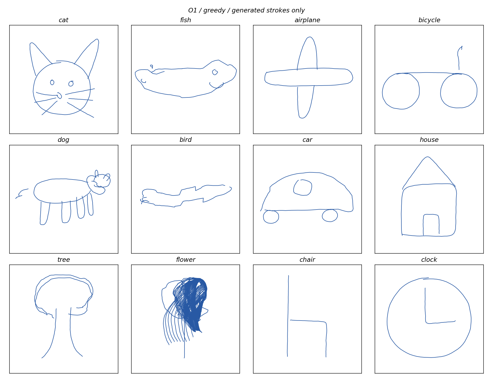
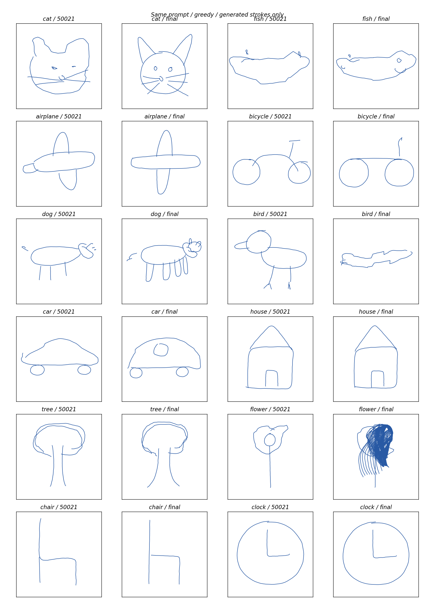
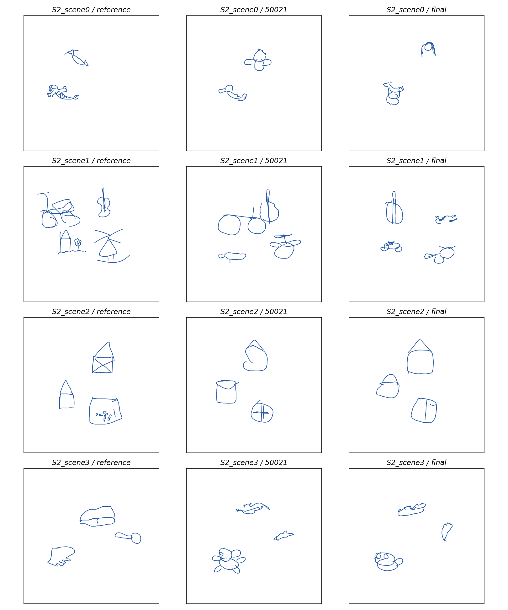

# Historical GMM autoregressive stage

The project has been exploring written and graphical expression since July
2026. Before the current block-diffusion work, a 94.7M-parameter autoregressive
prior used a GMM density head with auxiliary shape and space heads. Both stages
share the frozen 48-dimensional stroke representation, but use different
generation and readout procedures.

## Object generation

This unedited grid retains all twelve fixed labels from the 2026-10-26 final
evaluation. Blue curves are generated strokes. Greedy drawing selects the mean
of the highest-weight GMM component. Cat, dog, car, house, tree and clock have
recognizable structure; other labels simplify or mix parts, and the flower
case degenerates into repeated strokes. The grid shows this model's object
generation rather than the current diffusion model's output.

## Within-stage progression

The comparison uses the same prompts and decoder at step 50,021 and final step
54,825. Some object details improve, while others regress. The final checkpoint
completed 3,600,001,122 successful inputs. Its training source is commit
`4b9b39df47902cf35516624c04e977a80b647aef`.

Each row shows a reference scene, step 50,021 and the final checkpoint. Generated
objects occupy several positions, with continuing errors in category, parts and
layout. These four previously fixed rows are illustrative samples.

## Text and other measured behavior

[All four fixed text continuations](historical_gmm_text.md) are included with
their prompts. The historical text path uses auxiliary shape/space readout,
prefix constraints, and canonical-font feedback; drawing uses the GMM path.
The complete continuations retain misspellings, topic shifts and repetition.

| Final-checkpoint measurement | Recorded result |
|---|---:|
| Complete object-name readout | 70/345 |
| Scene-question answers | 41/96 |
| Naming the circled object | 12/96 |
| Selecting the named object by a circle | 37/96 |

These tasks and decoding procedures differ from the diffusion evaluation's
512-scene selection protocol. The separate tables preserve their populations
and do not form a matched cross-model comparison.

The [compact evidence record](evidence/historical_gmm.json) includes checkpoint
identity, both snapshot metrics, readout settings and image checksums. Code for
this stage remains in `src/st/pretrain_model.py`, the generation/readout modules,
and the `r_joint_scratch_20261022.json` recipe. Matching historical weights are
listed as not yet published in `assets/manifest.json`.
